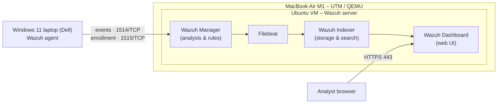
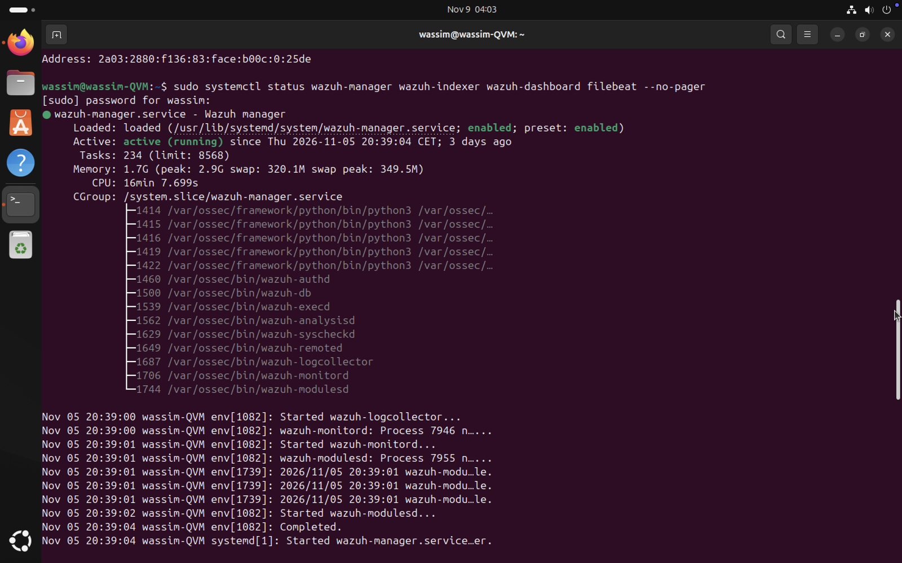
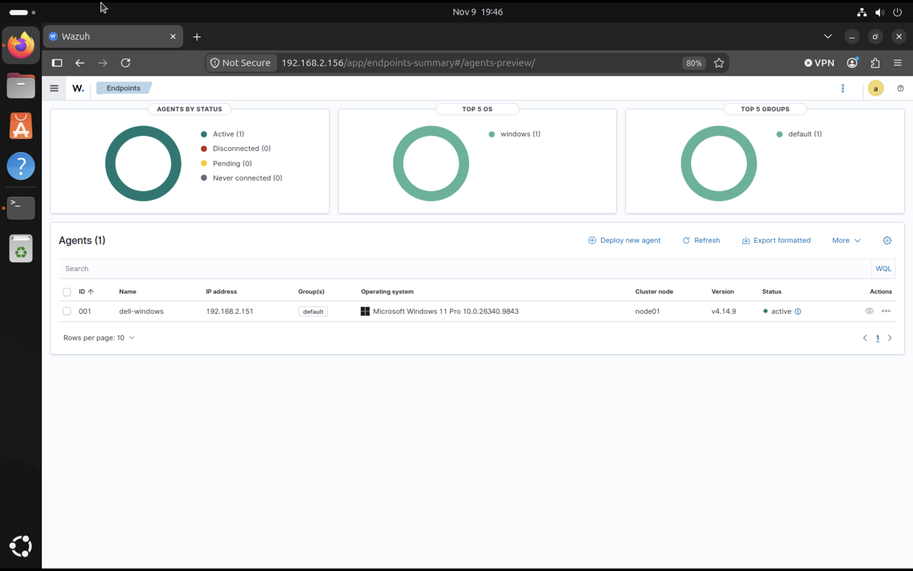
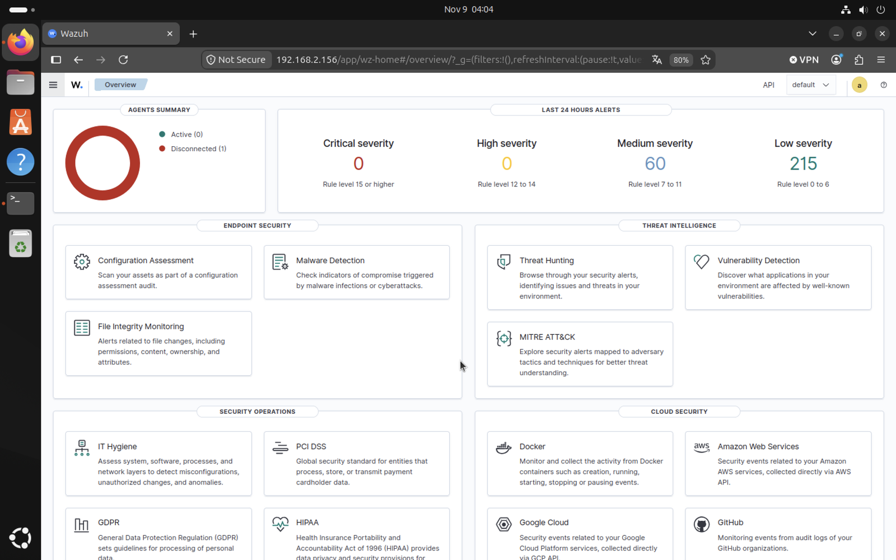
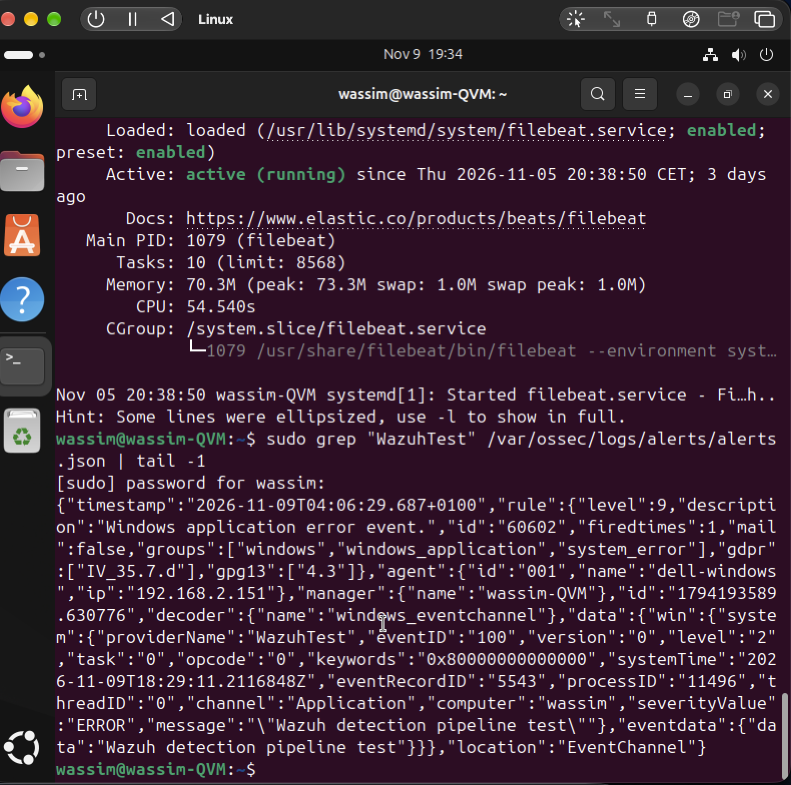
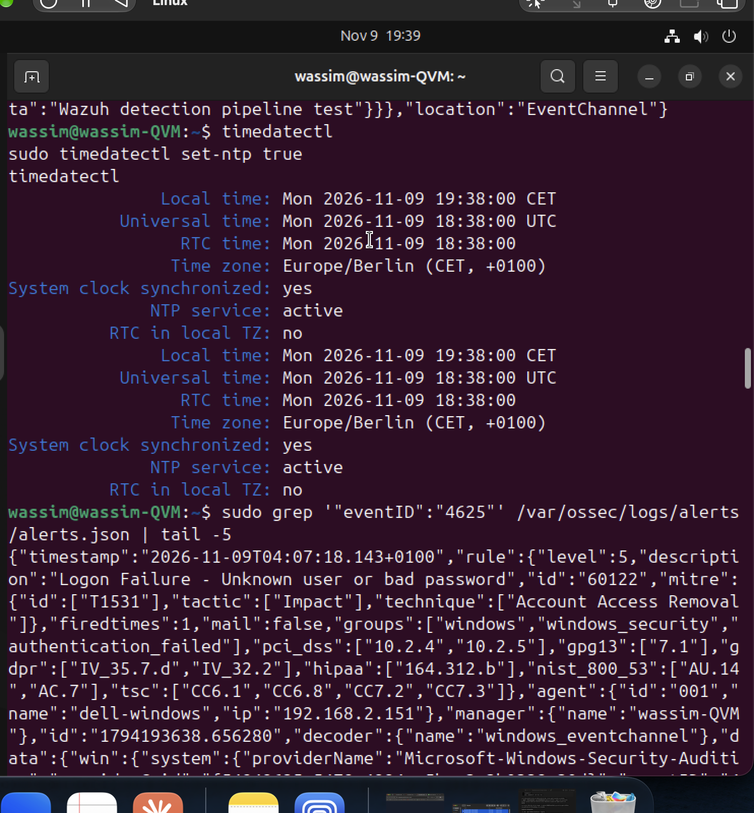

# Wazuh SOC Lab

Hands-on SOC lab built around **Wazuh (SIEM/XDR)**: deploying the Wazuh stack, enrolling a Windows 11 endpoint, collecting Windows security events and analyzing alerts.

> **Scope — what this repository documents**
> - **Master's project (ISSAT Gafsa, 2024):** academic project combining penetration testing with a Wazuh monitoring environment.
> - **Personal lab (since 08/2026):** my own Wazuh 4.14.9 lab at home.
>
> Both are **lab environments**, not production SOC work. My professional experience is in 1st level IT support.

---

## Architecture



| Component | Role |
|---|---|
| Wazuh Manager | Receives agent events, decodes them and matches detection rules |
| Filebeat | Forwards alerts from the Manager to the Indexer |
| Wazuh Indexer | Stores and indexes alerts and events |
| Wazuh Dashboard | Web interface to search events and review alerts |
| Wazuh agent (Windows 11) | Collects Windows Event Logs and security configuration data |

Details: [docs/01-architecture.md](docs/01-architecture.md)

---

## Screenshots

**Wazuh stack running on Ubuntu**



**Windows 11 agent active**



**Dashboard overview**



**Detection test: Windows event → Wazuh alert (rule 60602)**



**Failed logon (Event ID 4625) → Wazuh rule 60122**



All screenshots: [screenshots/](screenshots/)

---

## What I did

**Deployment**
- Installed Wazuh on Ubuntu (Manager, Indexer, Dashboard) and configured Filebeat
- Checked the status of all Wazuh services
- Installed the Wazuh agent on Windows 11, registered it with the Manager and verified communication
- Personal lab: configured networking between the UTM virtual machine and the physical Windows laptop and troubleshot agent connectivity

**Log collection & analysis**
- Collected Windows security events from the Windows 11 endpoint
- Reviewed events and alerts in the Wazuh Dashboard
- Read raw alerts and events in the Wazuh log files (JSON)

**Detection tests**
- Generated a Windows test event with `eventcreate` and followed it through the pipeline: endpoint → agent → Manager → rules → alert — result: rule **60602** (level 9) on agent `dell-windows` — [docs/03-detection-test-eventcreate.md](docs/03-detection-test-eventcreate.md)
- Found a VM clock drift (alert timestamp ≠ event time) and fixed it by enabling NTP on the VM
- Ran the **CIS Microsoft Windows 11 Enterprise Benchmark v3.0.0** (Security Configuration Assessment): 482 checks, 114 passed, 359 failed, score **24 %** — linked the failing account-lockout policy to the 4625 scenario — [docs/04-cis-benchmark-sca.md](docs/04-cis-benchmark-sca.md)

**Scenario: failed Windows logons (Event ID 4625)**
- Generated failed sign-ins on the endpoint; Wazuh raised rule **60122** ("Logon Failure - Unknown user or bad password")
- Analyzed the event fields (logon type 2, status / sub-status, source 127.0.0.1) and wrote an incident report — [docs/05](docs/05-failed-logons-4625.md) · [report](incident-reports/2026-11-09-failed-logons-4625.md)

**Penetration testing (Master's project)**
- Reconnaissance, network scanning and service identification with Nmap, vulnerability identification and analysis of results

---

## Detection pipeline

1. An event is generated on the endpoint
2. The Wazuh agent collects it
3. The agent sends it to the Wazuh Manager
4. The Manager decodes it and evaluates the detection rules
5. If a rule matches, an alert is generated
6. The alert is indexed and reviewed in the Dashboard

---

## Repository structure

```
wazuh-soc-lab/
├── README.md
├── docs/
│   ├── 01-architecture.md
│   ├── 02-installation.md
│   ├── 03-detection-test-eventcreate.md
│   ├── 04-cis-benchmark-sca.md
│   └── 05-failed-logons-4625.md
├── incident-reports/
│   ├── TEMPLATE.md
│   └── 2026-11-09-failed-logons-4625.md
└── screenshots/
    └── README.md
```

---

## Roadmap (planned — not done yet)

- [ ] Add Sysmon on the Windows endpoint for process and network telemetry
- [ ] File Integrity Monitoring on a monitored folder
- [ ] SSH brute-force simulation against my own Ubuntu VM and the resulting alerts
- [ ] First custom detection rule (threshold of repeated 4625 events on one host)
- [ ] Wazuh Vulnerability Detection on the Windows endpoint
- [ ] Map each scenario to MITRE ATT&CK and write an incident report

---

## Skills

Wazuh · SIEM · Security monitoring · Windows Event Logs · Log & alert analysis · Ubuntu Linux · Windows 11 · Networking (TCP/IP, ports) · Virtualization (UTM/QEMU) · Nmap

**Author:** Wassim Boubaker — [Portfolio](https://boubakerwassim.github.io) · [LinkedIn](https://www.linkedin.com/in/wassim-boubaker)
