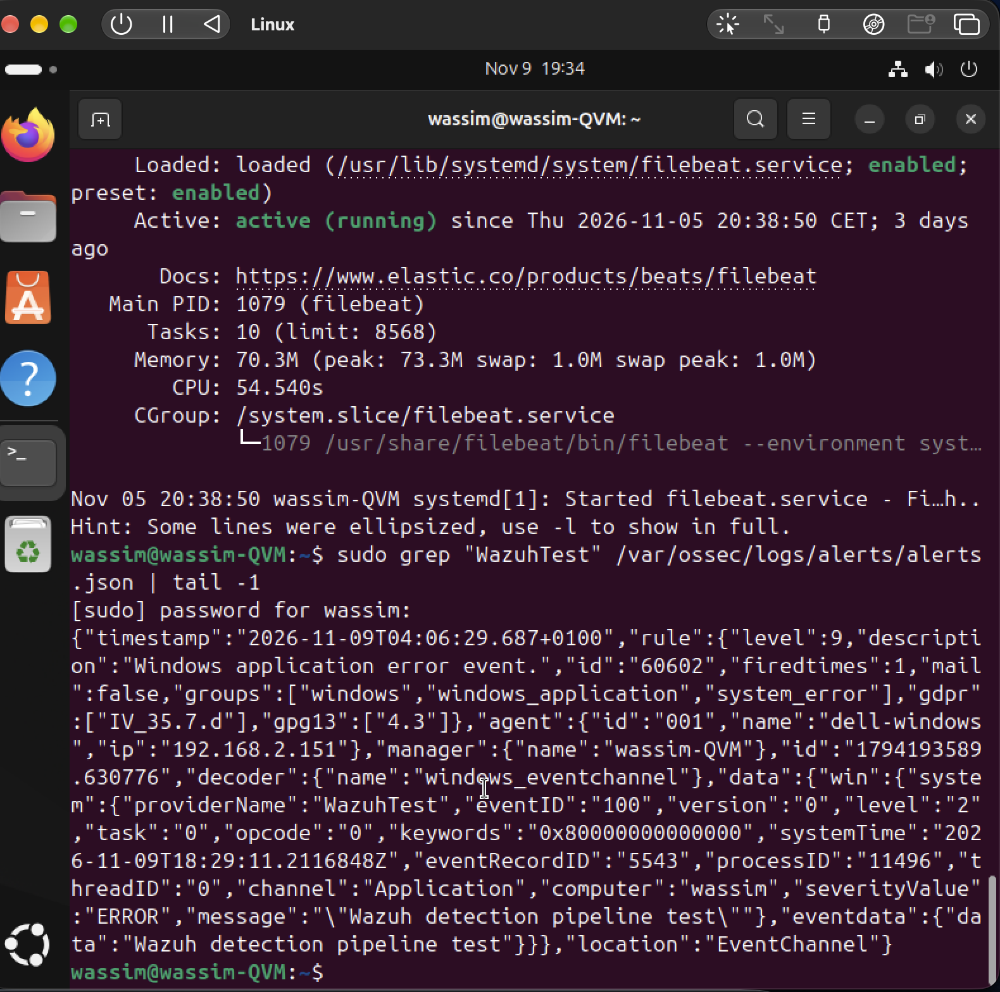

# 03 – Detection test with `eventcreate`

## Goal

Verify the full detection pipeline with a controlled, harmless test event:

endpoint → agent → Manager → rules → alert → Dashboard

## 1. Generate a test event on Windows 11

Command prompt as administrator:

```cmd
eventcreate /T ERROR /ID 100 /L APPLICATION /SO WazuhTest /D "Wazuh detection pipeline test"
```

The event appears in **Event Viewer → Windows Logs → Application** with source `WazuhTest` and Event ID `100`.

## 2. Check collection and processing

- **Dashboard:** search the endpoint's events for `data.win.system.eventID: 100` or the source `WazuhTest`.
- **Server (JSON):**

```bash
sudo grep "WazuhTest" /var/ossec/logs/alerts/alerts.json
```

## 3. Interpretation

- **Alert present:** a rule matched the event; review the rule ID, level and description in the alert.
- **No alert:** the event can still be received but not match any rule at an alerting level. To see every received event (not only alerts), enable `<logall_json>yes</logall_json>` in the Manager's `ossec.conf` and check `/var/ossec/logs/archives/archives.json`. Disable it again afterwards because it grows quickly.

## Result in my lab (personal lab, 09/11/2026)

The test event was collected and raised an alert:

| Field | Value |
|---|---|
| Rule | **60602** – "Windows application error event" |
| Level | 9 |
| Groups | windows, windows_application, system_error |
| Decoder | windows_eventchannel |
| Agent | 001 – dell-windows |
| Channel / Event ID | Application / 100 (provider `WazuhTest`) |



### Finding: clock drift on the Wazuh VM

The alert `timestamp` (written by the Manager) did not match the event's `systemTime` (written by Windows). The Ubuntu VM clock was out of sync, most likely after the UTM VM had been suspended. In a SOC, wrong timestamps break timelines and correlation, so the VM clock must stay synchronized:

```bash
timedatectl                    # check "System clock synchronized: yes"
sudo timedatectl set-ntp true  # enable NTP synchronization
```

## What this test shows

- The agent collects Windows Event Logs from the Application channel
- Events reach the Manager and are evaluated against the rules
- Alerts can be traced from the endpoint to the Dashboard and the raw JSON
