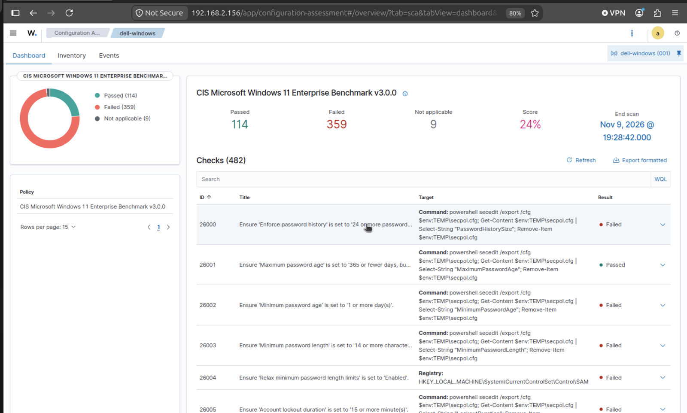

# 04 – CIS Benchmark alerts (Security Configuration Assessment)

## What it is

Wazuh's **Security Configuration Assessment (SCA)** module checks the endpoint's configuration against a hardening policy. On the Windows 11 endpoint it uses the **CIS Microsoft Windows 11 Enterprise Benchmark**.

Each check returns **passed**, **failed** or **not applicable**. Failed checks generate alerts that point to configuration weaknesses (for example password policy, audit policy or service settings).

## Where to see the results

- **Dashboard:** the agent's **Configuration Assessment** view lists the policy, score and every check
- **Alerts:** SCA results also appear as alerts for the agent (`rule.groups: sca`)

## Result in my lab (personal lab, scan 09/11/2026 19:28)

Endpoint: `dell-windows` – Windows 11 Pro, Wazuh agent v4.14.9 (Active)

| Policy | Checks | Passed | Failed | Not applicable | Score |
|---|---|---|---|---|---|
| CIS Microsoft Windows 11 Enterprise Benchmark v3.0.0 | 482 | 114 | 359 | 9 | **24 %** |

Examples of checks:

| ID | Check | Result |
|---|---|---|
| 26000 | Enforce password history ≥ 24 | Failed |
| 26001 | Maximum password age ≤ 365 days | Passed |
| 26002 | Minimum password age ≥ 1 day | Failed |
| 26003 | Minimum password length ≥ 14 | Failed |
| 26005 | Account lockout duration ≥ 15 minutes | Failed |

### Interpretation

- A score of 24 % is expected for a personal laptop with default settings: the CIS benchmark targets hardened **enterprise** systems (the endpoint runs Windows 11 **Pro**).
- **Link to the 4625 scenario:** the account lockout and password-policy checks fail. Without an account lockout policy, repeated failed logons are never blocked — exactly the weakness a brute-force attempt exploits. Detection (rule 60122) and hardening (lockout policy) belong together.

## How I used it

- Observed alerts generated by the CIS Windows 11 Enterprise Benchmark checks
- Reviewed failed checks, their description, rationale and the recommended remediation

## Why it matters for a SOC

- Hardening gaps increase the attack surface; SCA makes them visible per endpoint
- It is a practical way to understand how a SIEM/XDR combines **detection** (events, rules) with **posture monitoring** (configuration)
