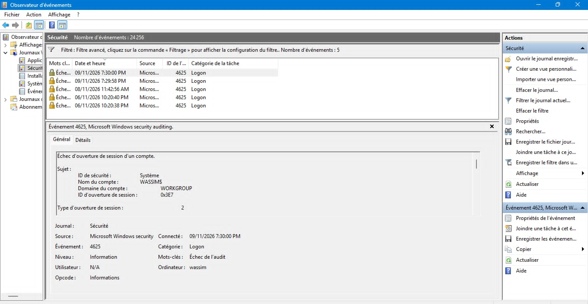
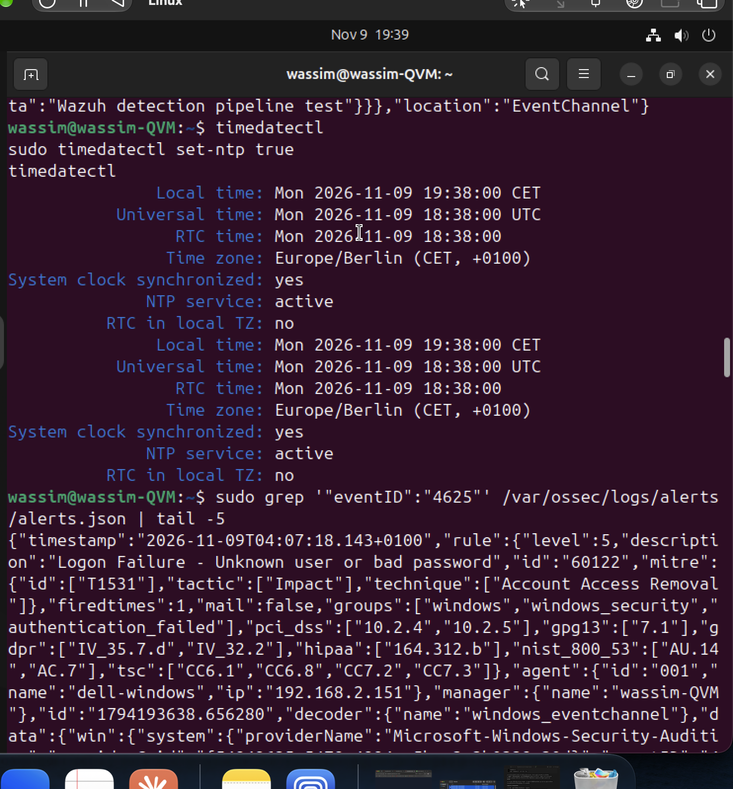
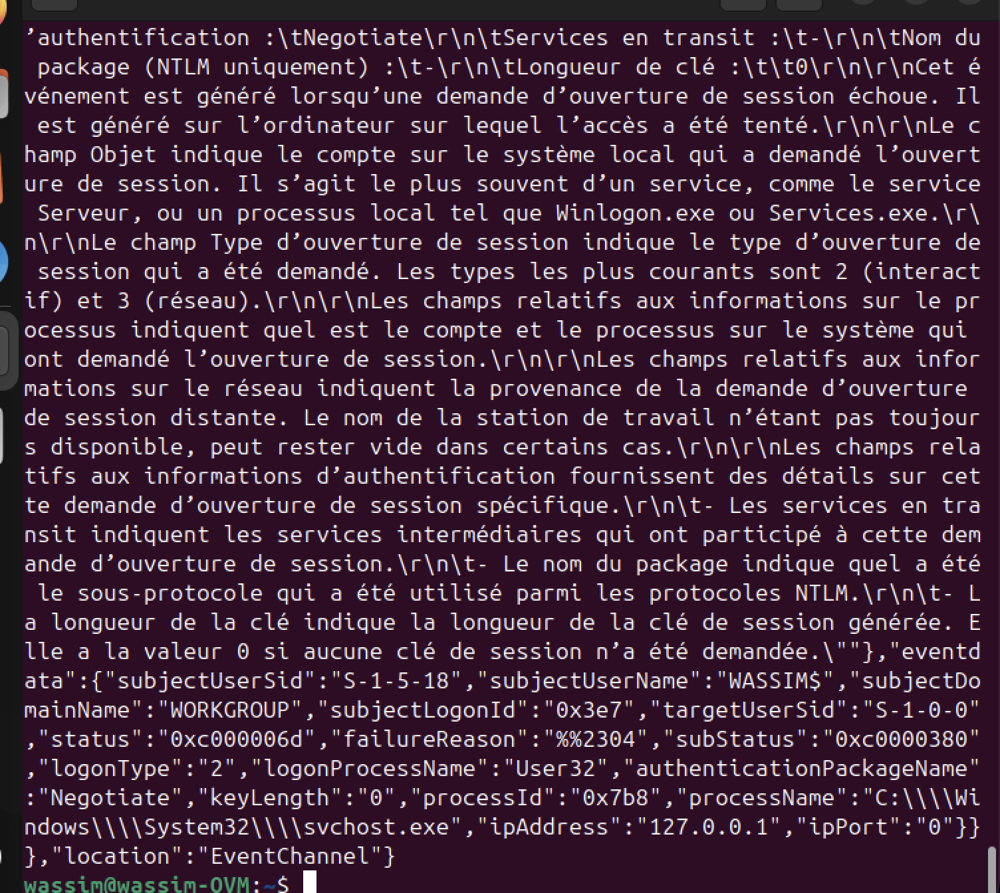

# 05 – Failed Windows logons (Event ID 4625)

## Goal

Detect failed logons on the Windows 11 endpoint — the first indicator of password guessing or brute force (MITRE ATT&CK **T1110 – Brute Force**).

## Step 1 – Generate and verify on Windows ✅

Failed sign-ins were generated on my own Windows 11 laptop at the lock screen. Event Viewer → Windows Logs → Security, filtered on Event ID 4625:

- Events "An account failed to log on" (Event ID 4625, task category *Logon*, keyword *Audit Failure*)
- Logon type **2** = interactive (local sign-in)



## Step 2 – Alert in Wazuh ✅

```bash
sudo grep '"eventID":"4625"' /var/ossec/logs/alerts/alerts.json | tail -5
```

| Field | Value |
|---|---|
| Rule | **60122** – "Logon Failure - Unknown user or bad password" |
| Level | 5 |
| Groups | windows, windows_security, authentication_failed |
| Compliance tags | PCI DSS 10.2.4 / 10.2.5, GDPR, HIPAA, NIST 800-53 AU.14 / AC.7 |
| MITRE (Wazuh default mapping) | T1531 – Account Access Removal |
| Agent | 001 – dell-windows |



## Step 3 – Analysis of the event fields

| Field | Value | Meaning |
|---|---|---|
| `logonType` | 2 | Interactive logon at the machine |
| `subjectUserName` / `subjectUserSid` | WASSIM$ / S-1-5-18 | The local SYSTEM account handled the request (normal for local sign-in) |
| `targetUserSid` / account name | S-1-0-0 / `-` | No valid account resolved for the attempt |
| `status` | 0xC000006D | Logon failure: wrong credentials |
| `subStatus` | 0xC0000380 | Wrong PIN (smart card / Windows Hello) |
| `processName` | `C:\Windows\System32\svchost.exe` | Local logon process |
| `ipAddress` | 127.0.0.1 | Local, not a network attempt |
| `logonProcessName` / package | User32 / Negotiate | Interactive Windows sign-in |



**Conclusion:** local interactive attempts with a wrong PIN, from the machine itself — consistent with my own test. No network source, no remote attempt.

**Observation on the MITRE mapping:** Wazuh maps rule 60122 to T1531 by default. For an analyst, a series of failed logons is first a sign of **T1110 – Brute Force**; mappings should be reviewed, not taken as-is.

## Step 4 – Incident report ✅

[incident-reports/2026-11-09-failed-logons-4625.md](../incident-reports/2026-11-09-failed-logons-4625.md)

## Next step

Custom rule: raise a higher-level alert when several 4625 events occur on the same host within a short time window (threshold-based brute-force detection).
